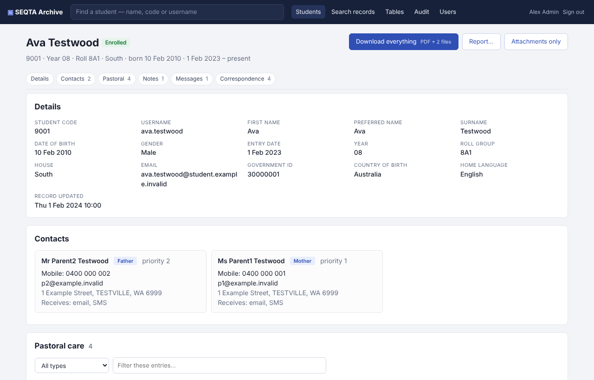

# SEQTA Archive

When a school stops using SEQTA, it gets an **offboarding export**: a folder named something like `au_wa_yourschool`, holding about 90 CSV files (some several GB) and a `files/` folder of attachments. It contains years of pastoral care notes, sickbay visits, support plans, medical and custody notes, and every email and SMS the system sent. The export is complete, but nobody can read it in that form.

SEQTA Archive turns that export into a **read-only, searchable, audited website** that deputies, year coordinators and student services can use to look up a student's history.



## What it does

- **Student profiles**: details, contacts, alerts, pastoral care, sickbay (including treatments), notes, support plans, goals, bullying incidents, SEQTA messages, every email, SMS and letter sent about the student, and documents. Nothing is truncated. Codes are shown as names: pastoral type, staff, house, year.
- **Search**: full-text search across pastoral notes, sickbay, notes, plans, messages and the bodies of the emails and SMS that were sent.
- **Export**: one ZIP per student, with the whole record as a PDF and the attachments in folders. There's also a printable report.
- **Audit log**: every profile, document, email and export someone opens is recorded against their name. Administrators can view the log in the app.
- **Raw tables**: every CSV is browsable for anything the profile pages don't cover.
- **Sign-in options**: built-in accounts (passwords, optional authenticator-app codes, lockout), or your own identity provider (Keycloak, Entra ID, Google Workspace and others) via oauth2-proxy.

It never writes to the SEQTA data. The database is opened read-only, and emails are shown in a sandbox with links, scripts and remote images switched off.

## Install

Choose the guide that matches what you have:

| You have | Guide |
|---|---|
| A Linux server with Docker | [docs/INSTALL-docker.md](docs/INSTALL-docker.md) |
| A Windows server or PC | [docs/INSTALL-windows.md](docs/INSTALL-windows.md) |
| A Linux VM (Debian/Ubuntu), no Docker | [docs/INSTALL-linux.md](docs/INSTALL-linux.md) |

Every path follows the same steps:

1. Install.
2. Point it at your export. Building the database takes 10–30 minutes for a large school, and the database is roughly 40% of the export's size.
3. Create the first administrator.
4. Put HTTPS in front.

For settings, see [docs/CONFIGURATION.md](docs/CONFIGURATION.md).

## Before you go live

This archive holds some of the most sensitive information a school has. Read [SECURITY.md](SECURITY.md) first. It covers who should have access, HTTPS, two-step sign-in, backups, retention, and getting rid of the copies of the export lying around once the archive is up.

## How it works

```
au_wa_yourschool/ ──► seqta-archive build ──► seqta.db (SQLite, read-only)  ─┐
  data/*.csv          (full text, compressed                                  ├─► seqta-archive serve ──► browser
  files/…             email bodies, FTS5 search)  files/ (attachments)      ─┘    (Flask + Waitress)
                                                  state.db (accounts + audit log)
```

- **Python 3.10+.** The only dependencies are Flask, Waitress and segno, with WeasyPrint optional for PDFs.
- **PDFs:** WeasyPrint on Linux and Docker. On Windows, Microsoft Edge in headless mode, which is already installed.
- **Data volume:** tested against a real export of about 6,000 students, 180,000 pastoral entries and 1.6 million correspondence items (15 GB of CSV). The build takes about 10 minutes, and profile pages load in well under a second.

## Development

```
pip install -e ".[test,pdf]"
pytest -q
python tests/make_fake_export.py /tmp/fake      # a fake export with invented students
seqta-archive build --export /tmp/fake
```

The tests and screenshots use **invented data only**. Never commit real exports, databases or screenshots of real records. `.gitignore` excludes the usual places, but check before you push.

## Licence

MIT. See [LICENSE](LICENSE). Not affiliated with or endorsed by Education Horizons / SEQTA.
